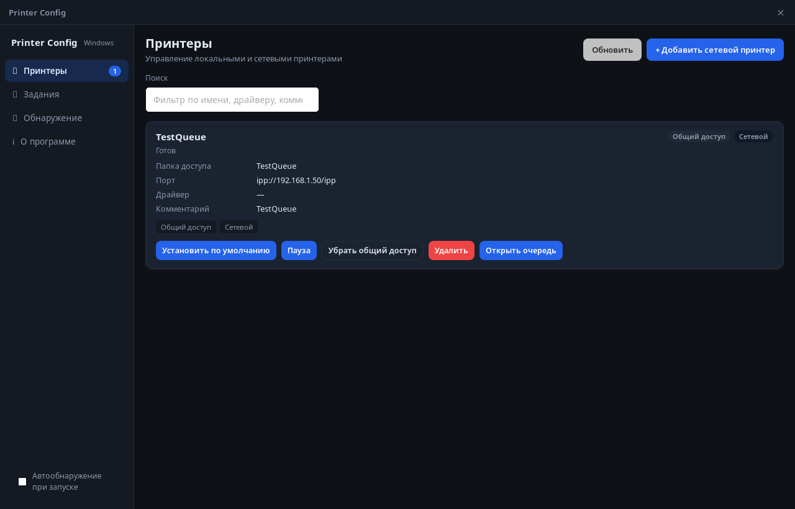

<div align="center">

# 🖨️ Printer Config

**Кроссплатформенный менеджер принтеров и очередей печати**

Tauri 2 · React 19 · Rust · CUPS / Windows Spooler

[](https://github.com/flytimopheev-sketch/printer-config/actions/workflows/rust.yml)
[](https://github.com/flytimopheev-sketch/printer-config/releases/latest)
[](LICENSE)
[](https://tauri.app)
[](https://react.dev)
[](https://www.rust-lang.org)

[⬇️ Скачать](https://github.com/flytimopheev-sketch/printer-config/releases/latest) ·
[🐛 Сообщить об ошибке](https://github.com/flytimopheev-sketch/printer-config/issues/new) ·
[🤝 Участие в проекте](CONTRIBUTING.md)

</div>



Printer Config — настольное приложение для управления принтерами и очередями
печати. На Windows работает через Spooler API, на Linux (в том числе РЕД ОС) —
через CUPS. Это один и тот же бинарник: RPM для РЕД ОС собирается из тех же
исходников, что и Windows-версия.

## Возможности

| Возможность                                        | Windows | Linux / РЕД ОС |
| --------------------------------------------------- | :-----: | :-----------: |
| Список принтеров, принтер по умолчанию               |   ✅    |      ✅       |
| Очередь заданий: отмена, пауза, перезапуск           |   ✅    |      ✅       |
| Общий доступ к принтеру                              |   ✅    |      ✅       |
| Свойства принтера (место, описание, опции драйвера)  |   ❌    |      ✅       |
| Уровень тонера/чернил, тестовая страница             |   ❌    |      ✅       |
| Обнаружение сетевых принтеров по mDNS/DNS-SD         |   ✅    |      ✅       |
| Веб-консоль принтера (embedded web server)           |   ✅    |      ✅       |
| Добавление принтера                                  | UNC-путь | IP / очередь / URI / UNC |

Дополнительно: тёмная тема, frameless-окно с собственной строкой заголовка,
всплывающие уведомления, запоминание размера окна, сводка диагностики для
отчётов об ошибках.

### Горячие клавиши

| Клавиши   | Действие                          |
| --------- | --------------------------------- |
| `F5`      | Обновить список принтеров          |
| `Ctrl+F`  | Перейти к поиску по принтерам      |
| `Esc`     | Закрыть открытый диалог            |

## Как это работает

Бэкенд выбирается на этапе компиляции — в одном приложении живут обе реализации:

| Платформа | Бэкенд                              | Модуль                    |
| --------- | ----------------------------------- | ------------------------- |
| Windows   | Spooler API (`winspool.drv`)        | `src-tauri/src/winspool.rs` |
| Linux     | CUPS: `lp`, `lpadmin`, `lpinfo`, `cupsd` | `src-tauri/src/cups.rs`     |

Обнаружение принтеров по mDNS/DNS-SD тоже реализовано для обеих платформ:

* **Linux / РЕД ОС** — через системную утилиту `avahi-browse` (пакет `avahi`);
* **Windows** — через чистый Rust-крейт [`mdns`](https://crates.io/crates/mdns),
  без установки Bonjour/Avahi в систему.

Настройки интерфейса хранятся в JSON:

* Windows — `%APPDATA%\printer-config\config.json`;
* Linux — `$XDG_CONFIG_HOME/printer-config/config.json`
  (по умолчанию `~/.config/printer-config/config.json`).

В этом файле сохраняются активная вкладка, последний выбранный принтер,
размер и развёрнутость окна, настройки поиска и автообнаружения.

## Диагностика

Кнопка «Собрать диагностику» во вкладке «О программе» собирает сводку:
версия приложения, ОС, путь к файлу настроек и список принтеров с портами и
драйверами. Текст можно скопировать в буфер обмена и приложить к issue —
так отчёт об ошибке не приходится составлять по памяти.

## Установка

### РЕД ОС / AlmaLinux / Fedora (RPM)

Готовые сборки публикуются в [Releases](https://github.com/flytimopheev-sketch/printer-config/releases):

```sh
sudo dnf install -y "Printer-Config-"*.rpm
```

Зависимости пакета: `cups`, `cups-client`, `xdg-utils`, `desktop-file-utils`,
`webkit2gtk4.1`, `gsettings-desktop-schemas`, `libnotify`, `avahi`.

### Windows

Готового инсталлятора пока нет — приложение собирается из исходников
(инструкция ниже в разделе «Сборка»). Требуется Windows 10/11 x64.

## Разработка

Требования: Node.js 20.19+ (или 22.12+), npm, Rust 1.90+, а на Linux —
системные библиотеки Tauri.

```sh
npm install          # зависимости фронтенда
npm run dev          # Vite-сервер с горячей перезагрузкой (без окна Tauri)
npm run tauri:dev    # приложение целиком (окно Tauri + Vite)
```

### Полезные команды

| Команда                    | Что делает                                        |
| -------------------------- | ------------------------------------------------- |
| `npm run build`            | Проверка типов (`tsc --noEmit`) + сборка фронтенда |
| `npm run typecheck`        | Только проверка типов                             |
| `npm run tauri:dev`        | Запуск приложения в режиме разработки              |
| `npm run tauri:build`      | Сборка приложения и всех пакетов для текущей ОС    |
| `npm run tauri:build:rpm`  | Сборка RPM-пакета (Linux)                          |
| `npm run tauri:build:nsis` | Сборка NSIS-установщика (Windows)                  |

### Сборка RPM локально

RPM собирается в контейнере `packaging/Dockerfile.build` на базе Fedora 37:
glibc 2.36 совпадает с РЕД ОС 8.0, поэтому бинарник запускается без ошибки
«GLIBC_x.xx not found».

```sh
# один раз собрать образ
docker build -f packaging/Dockerfile.build -t printer-build .

# собрать .rpm (результат: src-tauri/target/release/bundle/rpm/*.rpm)
docker run --rm -v "$PWD":/app -w /app printer-build \
  bash -c 'npm ci && npm run tauri:build:rpm'
```

### Сборка под Windows

```sh
npm install
npm run tauri:build:nsis   # или npm run tauri:build — установщик по умолчанию
```

Для сборки Tauri на Windows нужен [WebView2](https://developer.microsoft.com/microsoft-edge/webview2/)
(предустановлен в Windows 11) и Visual Studio Build Tools с компонентом
«Разработка классических приложений на C++».

## Релизы

Каждый тег `v*` запускает сборку RPM в CI и публикует
`Printer-Config-<версия>-<релиз>.<arch>.rpm` в GitHub Releases:

```sh
git tag v1.3.0
git push origin v1.3.0
```

Перед тегом обновите версию в трёх местах: `package.json`,
`src-tauri/Cargo.toml`, `src-tauri/tauri.conf.json` — и добавьте запись
в [CHANGELOG.md](CHANGELOG.md).

## Структура проекта

```
.
├── src/                     # фронтенд (React + TypeScript)
│   ├── App.tsx              # корневой компонент, состояние и навигация
│   ├── components/          # карточки принтеров/заданий, модальные окна, тосты
│   ├── views/               # вкладки: принтеры, задания, обнаружение, о программе
│   ├── lib/api.ts           # типизированные обёртки над Tauri invoke/event
│   └── styles.css           # тёмная тема
├── src-tauri/               # бэкенд (Rust + Tauri)
│   ├── src/commands.rs      # Tauri-команды (мост UI ↔ бэкенд)
│   ├── src/winspool.rs      # Windows: Spooler API
│   ├── src/cups.rs          # Linux: CUPS
│   ├── src/discovery.rs     # mDNS-обнаружение (avahi / чистый Rust)
│   ├── src/config.rs        # сохранение настроек
│   ├── tauri.conf.json      # конфигурация Tauri и параметры пакета
│   └── Cargo.toml
├── packaging/               # контейнер для сборки RPM
├── reference/               # исходники GNOME system-config-printer (справочно)
├── .github/workflows/       # CI: сборка, тесты, релиз RPM
└── CHANGELOG.md             # история изменений
```

## Известные ограничения

* **Свойства принтера** (уровень тонера, PPD-опции, тестовая страница)
  реализованы только для Linux/CUPS. На Windows доступны базовые операции
  со Spooler API.
* **Добавление принтера на Windows** принимает только UNC-путь
  (`\\сервер\очередь`). Ввод IP-адреса, очереди или device-uri (`ipp://…`)
  работает в Linux-версии.
* **Обнаружение по mDNS** на Linux требует пакет `avahi`; без него вкладка
  «Обнаружение» сообщит об ошибке, остальные функции приложения работают
  нормально.
* На РЕД ОС 8.0 при запуске может появляться
  `GLib-GIO-CRITICAL … g_settings_schema_source_lookup` — это означает, что
  не установлены GSettings-схемы GNOME. Помогает пакет
  `gsettings-desktop-schemas` (он уже в зависимостях RPM).

## Документация

* [CONTRIBUTING.md](CONTRIBUTING.md) — как собрать проект и отправить PR.
* [CHANGELOG.md](CHANGELOG.md) — что изменилось в каждом релизе.
* [SECURITY.md](SECURITY.md) — как сообщить об уязвимости.
* [CODE_OF_CONDUCT.md](CODE_OF_CONDUCT.md) — правила участия в проекте.
* [reference/README.md](reference/README.md) — оригинальный
  `system-config-printer` (GNOME), для которого сделан этот проект.

## Лицензия

MIT — см. [LICENSE](LICENSE). Файл `reference/system-config-printer.py`
принадлежит проекту GNOME и распространяется по GPL-2.0; он включён только
для сравнения реализаций и не входит в состав приложения.

## Контакты

flytimopheev@gmail.com
